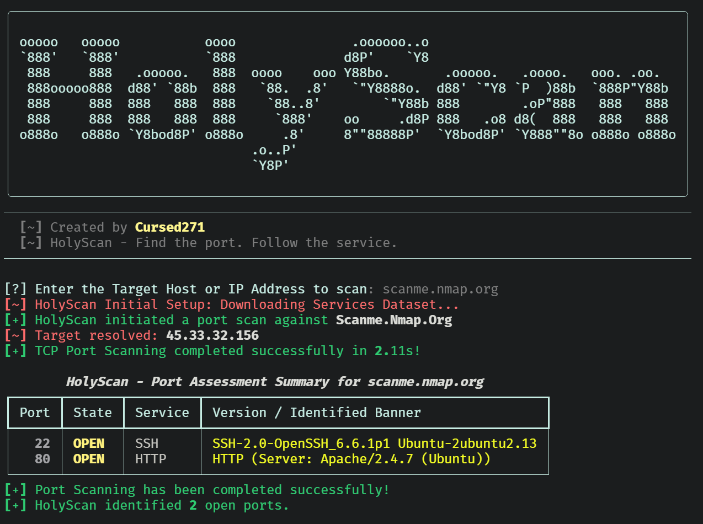

<div align="center">

  

  <h1>HolyScan</h1>

  <p align="center">
    
  </p>

  <p align="center">
    
    
    
    
    <a href="./LICENSE">
      
    </a>
  </p>

  <p>Find the Port. Follow the Service.</p>

</div>


## Overview

HolyScan is a Python TCP port-assessment utility for authorized security testing.

It performs asynchronous TCP connection checks, identifies likely service names from port numbers, attempts TLS and HTTP-oriented banner extraction, and exports structured JSON findings.

> HolyScan identifies TCP ports that accept a connection. An open TCP socket does not by itself prove service identity, version, exploitability, or business impact.

## Features

| Capability | What it does |
| :--- | :--- |
| Asynchronous TCP scanning | Uses asyncio sockets and semaphores to test selected TCP ports. |
| Top-port mode | Downloads and caches Nmap's service-frequency dataset, then selects the 1,000 most common TCP ports. |
| Custom port selection | Accepts comma-separated ports or an inclusive numeric range. |
| Audit port set | Scans a predefined set of high-value administrative, database, remote-access, and web ports. |
| Full TCP range | Scans TCP ports 1 through 65535. |
| Service identification | Maps open ports to TCP service names through `socket.getservbyport()`. |
| Banner extraction | Attempts TLS certificate inspection, HTTP `HEAD` requests, and generic banner collection. |
| Concurrency control | Uses an asyncio semaphore with a configurable worker limit. |
| JSON reporting | Saves port, state, service, and banner findings to a JSON file. |

## Screenshots:

### Interface


## Scan Modes

| Mode | Option | Port selection |
| :--- | :--- | :--- |
| Default top ports | None | 1,000 most common TCP ports from the cached Nmap services dataset |
| Custom selection | `--ports` | Explicit comma-separated ports or a range such as `1-1024` |
| Audit selection | `--audit` | Predefined high-value port list |
| Full scan | `--full` or `-p-` | TCP ports 1 through 65535 |

The audit port set includes ports commonly associated with FTP, SSH, Telnet, SMTP, DNS, HTTP, POP3, SMB, IMAP, HTTPS, Microsoft SQL Server, Oracle, MySQL, RDP, PostgreSQL, VNC, Redis, common web-application ports, Elasticsearch, and MongoDB.

## Technology

| Component | Purpose |
| :--- | :--- |
| Python | Application runtime |
| asyncio | Concurrent TCP connection checks |
| Typer | Command-line options and help |
| Rich | Banner, progress indicators, and result table |
| socket | Service-name lookup and banner probes |
| ssl | TLS connection inspection and certificate common-name extraction |
| urllib.request | Nmap services dataset download and caching |
| json / pathlib | Report serialization and file creation |

## Installation

### Prerequisites

- Python 3 with `pip`.
- Internet access for the initial Nmap services dataset download.
- Permission to make outbound TCP connections to the authorized target.

Install dependencies:

```bash
python3 -m pip install rich typer
```

Clone and run:

```bash
git clone https://github.com/Cursed271/HolyScan.git
cd HolyScan
python3 HolyScan.py --help
```

Use an isolated Python environment. If your environment uses `python` rather than `python3`, substitute that interpreter consistently.

## Usage

Use HolyScan only against systems you are explicitly authorized to assess.

| Use case | Command |
| :--- | :--- |
| Interactive scan | `python3 HolyScan.py` |
| Display help | `python3 HolyScan.py --help` |
| Scan top ports | `python3 HolyScan.py -t 192.168.1.10 --top-ports` |
| Scan selected ports | `python3 HolyScan.py -t 192.168.1.10 -p 80,443,8080` |
| Scan a port range | `python3 HolyScan.py -t 192.168.1.10 -p 1-1024` |
| Audit high-value ports | `python3 HolyScan.py -t 192.168.1.10 --audit` |
| Full TCP scan | `python3 HolyScan.py -t 192.168.1.10 --full` |
| Set concurrency | `python3 HolyScan.py -t 192.168.1.10 -p 1-1024 -n 250` |
| Set timeout | `python3 HolyScan.py -t 192.168.1.10 -p 1-1024 -w 2.0` |
| Export JSON | `python3 HolyScan.py -t 192.168.1.10 -p 80,443 -o reports/holyscan.json` |

## Command-Line Options

| Option | Short | Default | Purpose |
| :--- | :--- | :--- | :--- |
| `--target` | `-t` | Interactive prompt | Target hostname or IP address |
| `--ports` | `-p` | None | Comma-separated ports or inclusive range |
| `--top-ports` | — | Disabled | Scan the 1,000 most common TCP ports |
| `--audit` | — | Disabled | Scan the predefined high-value port set |
| `--full` | `-p-` | Disabled | Scan all 65,535 TCP ports |
| `--threads` | `-n` | `500` | Asynchronous concurrency limit |
| `--timeout` | `-w` | `1.0` | TCP connection timeout in seconds |
| `--output` | `-o` | None | JSON report destination |
| `--help` | `-h` | — | Show help |

## Output & Interpretation

HolyScan prints a terminal table containing the port, connection state, service label, and extracted banner or TLS information.

Illustrative JSON record:

```json
[
  {
    "port": 443,
    "state": "open",
    "service": "HTTPS",
    "banner": "TLS/HTTPS (CN: lab-host.example)"
  }
]
```

This example describes the format, not an actual scan result.

| Field | Interpretation |
| :--- | :--- |
| `port` | TCP port that accepted a connection |
| `state` | Always `open` for reported findings |
| `service` | IANA-style service label from the local port mapping |
| `banner` | TLS certificate common name, HTTP server header, first response line, or `No Banner Available` |

### Banner Behavior

- TLS probing disables certificate hostname and chain verification to maximize protocol inspection.
- HTTP probing sends a `HEAD / HTTP/1.1` request with a browser-style User-Agent header.
- Generic probing sends a carriage return and newline, then reads the initial response.
- Banner extraction is best-effort and may return no useful data for binary, filtered, or non-HTTP services.

## Known Limitations

- HolyScan scans one target host per execution.
- The tool performs TCP connect checks; it does not implement SYN, UDP, service-version, vulnerability, or authenticated scanning.
- Service labels come from a local port-to-service mapping and are not verified through protocol negotiation.
- Full-range scans create a very large task list and may consume substantial memory.
- The Nmap dataset download uses a fixed remote URL and falls back to ports 1 through 1,000 when unavailable.
- Banner probes can generate unexpected requests on production services.
- TLS certificate verification is intentionally disabled for banner extraction.
- JSON exports overwrite the selected destination file.

## Safe Use

- Obtain explicit written authorization before scanning.
- Begin with a small, explicitly selected port set.
- Avoid full-range scans against production, shared, or fragile infrastructure.
- Reduce concurrency and increase timeout values on sensitive networks.
- Treat an open port as an observation, not a confirmed vulnerability.
- Protect JSON reports containing internal addresses, hostnames, and service details.

## Troubleshooting

| Problem | What to check |
| :--- | :--- |
| Target cannot resolve | DNS availability and hostname spelling |
| No open ports | Firewall policy, routing, target availability, timeout, and port selection |
| Slow scan | Target count, concurrency, timeout, and network latency |
| Unexpected service label | Local port mapping versus actual protocol behavior |
| No useful banner | Service protocol, TLS configuration, and application behavior |
| JSON export fails | Destination permissions and filesystem availability |

## Version History

| Version | Scope |
| :--- | :--- |
| Version 1 | Asynchronous TCP scanning, top-port and audit selections, banner probes, and JSON export |


## License & Usage

HolyScan is distributed under the CursedSec Ownership Edict (COE).

Read [LICENSE](./LICENSE) for the applicable permissions, restrictions, contribution terms, and disclaimers. Public source availability is not a substitute for those terms.

## Feedback & Contributions

Use the repository's bug-report or feature-request template when issue submission is available.

Include the version, operating system, command, sanitized output, and reproduction steps. Never publish client scan results, credentials, sensitive infrastructure details, or evidence containing confidential data.

Check the security-reporting instructions before disclosing a vulnerability. Review the license and contribution terms before submitting modifications.

## Connect & Collaborate

<div align="center">

  <a href="https://github.com/Cursed271">
    
  </a>
  <a href="https://www.cursedsec.com/">
    
  </a>
  <a href="https://www.linkedin.com/in/cursed271/">
    
  </a>

  <p>Find the port. Follow the service. Document the evidence.</p>
  <sub>CursedSec.com · Cursed271 · HolyScan</sub>

</div>


